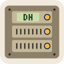

# lazy-avatars

[](https://www.npmjs.com/package/lazy-avatars) [](https://www.npmjs.com/package/lazy-avatars) [](https://github.com/paulaquiin/lazy-avatars/actions/workflows/ci.yml) [](https://github.com/paulaquiin/lazy-avatars/blob/main/docs/COMPATIBILITY.md) [](https://github.com/paulaquiin/lazy-avatars/blob/main/LICENSE)

Librería de avatares SVG deterministas para aplicaciones JavaScript y TypeScript: personas, equipos, servidores y bots. Trece colecciones originales, núcleo sin dependencias de ejecución, entradas opcionales React y web component, y arte original bajo MIT.

[English](README.md) · [Galería](https://lazyavatars.paulaquiin.com/) · [CI](https://github.com/paulaquiin/lazy-avatars/actions/workflows/ci.yml) · [Arquitectura](docs/ARCHITECTURE.md) · [Guía](PLAN.md) · [MIT](LICENSE)

> **Un único paquete.** Núcleo, trece colecciones y entradas opcionales /react, /web-component, /cli y /http. React sigue siendo opcional. Consulta el [registro de publicaciones](docs/RELEASING.md).

## Vista de las colecciones

SVG reales generados con la librería. Los ejemplos usan `seed: 'Ada Moss'`, `size: 128` y `shape: 'rounded'`; Rack usa `demo-host-01` con `status: 'warn'`, como en el código de abajo. [Explora las variantes en la galería](https://lazyavatars.paulaquiin.com/).

| <br>Mosaico                  | <br>Monograma | <br>Rack      | <br>Siesta  |
| ------------------------------------------------------------------------------------------------------- | -------------------------------------------------------------------------------------------- | ----------------------------------------------------------------------------------- | ------------------------------------------------------------------------------------- |
| <br>Origami                 | <br>Despensa     | <br>Déco      | <br>Latte     |
| <br>Constelación | <br>Hojalata     | <br>Órbita | <br>Misión |
| <br>Casco                      |                                                                                              |                                                                                     |                                                                                       |

## Uso

Instala el paquete ESM (Node.js 24.11+ en la rama 24.x, o 26+, y bundlers modernos de navegador):

```sh
npm install lazy-avatars@1.1.3
```

Importa el motor y la colección que necesites:

```ts
import { createAvatar, createAvatarDataUri } from 'lazy-avatars';
import { rack } from 'lazy-avatars/rack';

const svg = createAvatar(rack, {
  seed: 'demo-host-01',
  size: 64,
  shape: 'rounded',
  title: 'Host de ejemplo — advertencia',
  options: { status: 'warn' },
});

const src = createAvatarDataUri(rack, {
  seed: 'demo-host-01',
  options: { status: 'warn' },
});
// Usar src en un  con un alt adecuado.
```

La entrada raíz exporta el motor y sus tipos. Cada colección se importa por separado, sin cargar las demás colecciones. El núcleo no depende del DOM, la red, fuentes del sistema ni paquetes de ejecución. Los SVG generados son autocontenidos.

| Colección    | Importación                  | Opciones                                                                                                                   |
| ------------ | ---------------------------- | -------------------------------------------------------------------------------------------------------------------------- |
| Mosaico      | `lazy-avatars/mosaic`        | `tile`: `arcs`, `triangles`                                                                                                |
| Monograma    | `lazy-avatars/monogram`      | `frame`: `circle`, `shield`, `diamond`                                                                                     |
| Rack         | `lazy-avatars/rack`          | `status`: `ok`, `warn`, `down`, `off`; `unit`: `disks`, `vent`                                                             |
| Siesta       | `lazy-avatars/siesta`        | `accessory`: `cap`, `zzz`, `mask`, `blanket`, `none`; `body`: `round`, `pear`, `cloud`; `mouth`: `smile`, `yawn`, `sleep`  |
| Origami      | `lazy-avatars/origami`       | `animal`: `fox`, `cat`, `bear`, `owl`                                                                                      |
| Despensa     | `lazy-avatars/pantry`        | `food`: `donut`, `citrus`, `egg`, `avocado`                                                                                |
| Déco         | `lazy-avatars/deco`          | `motif`: `fan`, `arches`, `sun`                                                                                            |
| Latte        | `lazy-avatars/latte`         | `art`: `heart`, `tulip`, `rosetta`, `rings`                                                                                |
| Constelación | `lazy-avatars/constellation` | Sin opciones propias                                                                                                       |
| Hojalata     | `lazy-avatars/tinbot`        | `antenna`: `single`, `double`, `dome`; `eyes`: `gauges`, `visor`, `mixed`; `mouth`: `grille`, `smile`, `dots`              |
| Órbita       | `lazy-avatars/orbit`         | `surface`: `bands`, `craters`; `ring`: `none`, `thin`, `wide`; `moon`: `none`, `small`                                     |
| Misión       | `lazy-avatars/mission`       | `badge`: `shield`, `round`, `hexagon`; `planet`: `striped`, `ringed`, `cratered`; `rocket`: `upright`, `tilted`            |
| Casco        | `lazy-avatars/helmet`        | `visor`: `round`, `wide`, `angular`; `reflection`: `ringed`, `cratered`, `crescent`; `antenna`: `none`, `single`, `double` |

Las opciones visuales omitidas se eligen según la semilla. Rack usa `off` por defecto: representa un estado que aporta tu aplicación, no monitoriza servidores. Añade siempre una etiqueta textual. Monograma usa trazos serif propios y Rack glifos de píxel propios y Misión trazos sans propios; no se distribuyen fuentes de terceros.

Temas: `pastel`, `corporate`, `night`, `earth`, `mono`, o una paleta/lista con los cinco roles. Las semillas se recortan, normalizan en NFC y conservan mayúsculas: `Ana` y `ana` difieren. Las vacías se rechazan. Misma colección, versión de salida, semilla normalizada y opciones efectivas producen los mismos bytes. Fija la versión del paquete o guarda el SVG para conservar una salida histórica. Consulta el [contrato completo](packages/core/README.md).

Al insertar SVG inline, proporciona un `idPrefix` distinto por instancia. Las data URI en `` aíslan las referencias automáticamente. `background: false` elimina el fondo común, no el dibujo propio: las teselas de Mosaico siguen siendo opacas. El objetivo de legibilidad es 32 px; 24 px es una prueba exigente.

## Galería

La portada presenta las colecciones con arte original y ejemplos de interfaz. Salta al generador, elige un estilo, prueba una semilla ficticia al azar o copia el comando de instalación.

Permite elegir colección, semilla, forma, tema, transparencia y variantes. Incluye tamaños de 24–128 px, variedad con 12/60 identidades ficticias, comparación de los cinco temas y las paletas propias, y ejemplos de miembros, comentarios, perfil y servidores. Las hojas de contacto se pueden revisar a 24, 32, 64 y 128 px, sobre páginas claras u oscuras. Permite copiar código de API/imagen y descargar SVG. La vista Familia espacial compara Constelación, Órbita, Misión y Casco con la misma semilla a 32/64/128 px. La pestaña React genera código del adaptador.

La URL guarda el estado, incluida la semilla: compartirla comparte ese texto. Usa nombres y hosts ficticios; el hash no anonimiza. No hay solicitudes de imágenes o fuentes remotas ni analítica.

## Integraciones

Una instalación: `npm install lazy-avatars@1.1.3`.
Usa `lazy-avatars/react`, `lazy-avatars/web-component`, `lazy-avatars/cli` y
`lazy-avatars/http`. React 19 es un peer opcional: solo se instala si lo necesitas.
El motor y las colecciones no cargan React, DOM ni código del servidor Node.
El archivo npm contiene todas las entradas; el bundle incorpora las que importas.
Consulta [migración y ejemplos](docs/INTEGRATIONS.md).

## Desarrollo

Requiere Node `^24.11.0 || >=26.0.0` y pnpm `11.25.0`:

```sh
pnpm install --frozen-lockfile
pnpm exec playwright install chromium
pnpm check
pnpm dev
```

En Linux usa `pnpm exec playwright install --with-deps chromium`. `pnpm dev` compila el núcleo, lo deja en observación e inicia la galería en la URL de Vite (normalmente `http://127.0.0.1:5173`). `pnpm typecheck` también compila primero las declaraciones para funcionar desde un checkout limpio.

Comprobaciones individuales: `pnpm lint`, `pnpm typecheck`, `pnpm test`, `pnpm build`, `pnpm check:repo`, `pnpm check:package`, `pnpm check:integrations`, `pnpm test:browser`, `pnpm check:docker`. Compila antes de comprobar el paquete o navegador por separado. `pnpm format` aplica formato y arreglos seguros; `pnpm changeset` registra cambios públicos.

Hay 123 tests unitarios, 20 snapshots por colección más la figura de prueba del motor, comprobaciones XML/tamaño con 60 semillas y todos los temas, 30 pruebas de Chromium e instalación real del tarball fuera del monorepo con sus tipos públicos. El análisis del grafo de importaciones verifica aislamiento entre colecciones y detecta chunks huérfanos o ausentes. El núcleo y sus módulos alcanzables tienen presupuesto de 24 KiB sin comprimir y 8 KiB gzip; el objetivo por SVG es 4 KiB. El CI cubre Linux/Node 24.11 y 26, y Windows/Node 24. Deno, Bun y edge siguen pendientes de certificación.

Git contiene fuentes públicas, documentación, arte revisado, scripts reproducibles del proyecto, pruebas y lockfile. El [.gitignore](.gitignore) excluye herramientas internas, estado de asistentes, credenciales, dependencias y builds. `check:repo` revisa rutas, patrones habituales de credenciales e historial disponible sin mostrar valores; no sustituye una auditoría exhaustiva. npm usa una lista positiva: entradas/chunks/tipos compilados, README, licencia, changelog y manifiesto. Consulta las [reglas de publicación](docs/REPOSITORY_HYGIENE.md).

## Fases siguientes

La fase 0 aporta motor y herramientas; las fases 1–3 completan trece colecciones y la galería. La fase 4 incorpora adaptadores React/web component/CLI/HTTP autoalojable. La fase 5 cierra la publicación estable de v1.0. La [guía](PLAN.md#9-hoja-de-ruta) detalla dependencias y criterios de cierre. No se promete una API pública de imágenes alojada por el proyecto.

## Licencia y usos permitidos

[MIT](LICENSE) cubre código, documentación y arte original, incluidos los avatares generados íntegramente con ese arte. Se permiten uso personal, educativo, interno y comercial, modificación y redistribución. Conserva copyright y licencia al redistribuir copias o partes sustanciales. No obliga a publicar el código de tu aplicación. Se proporciona sin garantía. Los futuros recursos de terceros conservarán sus propias condiciones y avisos.

Contribuir: [guía](CONTRIBUTING.md). [Identidad Siesta](assets/brand/README.md) original MIT; [avisos de terceros](THIRD_PARTY_NOTICES.md).

Comparativa con fuentes: [lazy-avatars, Boring Avatars y DiceBear](docs/comparison.md). [Descubrimiento y tareas de publicación](docs/DISCOVERY.md).
