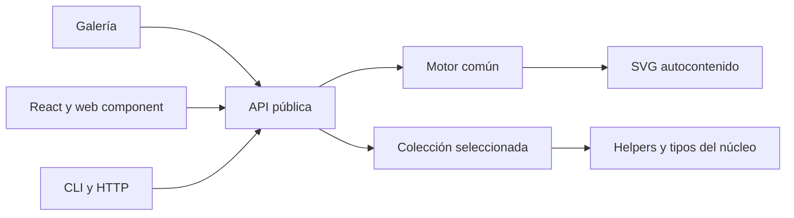

# Arquitectura de lazy-avatars

Estado: diseño para implementar. Fecha: 2026-10-23. La [guía](../PLAN.md) define las colecciones y el alcance; este documento concreta los límites técnicos. No describe código existente.

## 1. Decisión principal

Monorepo TypeScript con pnpm workspaces. El producto principal será una librería de funciones puras que recibe una colección y opciones y devuelve un SVG autocontenido. No necesita base de datos, almacenamiento de imágenes, red ni framework de interfaz.

Esta estructura permite compartir contratos y pruebas entre las colecciones sin obligar a sus consumidores a instalar la galería o las integraciones. No añadiremos un orquestador de monorepo mientras los scripts de pnpm sean suficientes.

```text
lazy-avatars/
├── packages/
│   ├── core/                  # lazy-avatars: motor y subrutas de colecciones
│   │   └── src/
│   │       ├── index.ts       # API y tipos comunes; no importa colecciones
│   │       ├── engine/        # hash, rng, svg, color, initials y glyphs
│   │       ├── themes/        # temas y roles de color
│   │       └── collections/   # una carpeta por colección
│   ├── react/                 # fase 4: @lazy-avatars/react
│   ├── web-component/         # fase 4: elemento <lazy-avatar>
│   ├── cli/                   # fase 4: @lazy-avatars/cli
│   └── http/                  # fase 4: servidor autoalojable y Dockerfile
├── apps/
│   └── gallery/               # Vite + TypeScript, sin framework
├── docs/                      # documentación pública
├── PLAN.md
├── README.md
├── README.es.md
└── LICENSE
```

Los directorios de código se crearán en su fase, sin paquetes vacíos. Los nombres npm son provisionales hasta comprobar su disponibilidad.

## 2. Dependencias y responsabilidades

| Componente | Responsabilidad | Límites |
| --- | --- | --- |
| Motor | Normalización, hash, RNG, color, glifos, SVG y envoltorio | Sin DOM, red, reloj, estado global mutable ni dependencias de ejecución |
| Colección | Dibujo, paletas, variantes y opciones tipadas | Usa contratos/helpers del núcleo; no importa otras colecciones |
| Galería | Controles, previsualización, URL compartible, descarga y ejemplos | Consume la API pública; sus dependencias nunca pasan al núcleo |
| Adaptadores | Integración con React, custom elements, terminal o HTTP | Consumen la API pública, sin duplicar el motor |



El consumidor importa explícitamente `lazy-avatars/rack`, por ejemplo, y pasa la colección a `createAvatar`. La entrada raíz no registra ni reexporta todas las colecciones. El mapa `exports` declarará únicamente API, tipos y subrutas públicas, sin exponer rutas internas accidentales. Las opciones de cada colección conservarán su inferencia TypeScript.

## 3. Flujo de generación y determinismo

1. Validar la colección y las opciones; normalizar la semilla con `trim()` + NFC. Conservar mayúsculas. Documentar y probar el comportamiento de semillas vacías y valores inválidos en fase 0.
2. Codificar en UTF-8 y aplicar FNV-1a de 32 bits a `${collection.id}:${seed}`. Los vectores de prueba fijarán el comportamiento para ASCII y Unicode.
3. Crear un RNG `mulberry32`. Cada `fork(nombre)` se deriva de la semilla raíz y de la ruta completa del subflujo, sin consumir el flujo padre. Los rasgos usan nombres estables (`palette`, `eyes`, etc.).
4. Resolver paleta y opciones sin alterar subflujos de otros rasgos. El orden de las opciones no debe modificar la salida.
5. Dibujar el contenido en `80 × 80`; aplicar forma, fondo, tamaño, título escapado y espacios de nombres en el envoltorio común. Usar serialización canónica, números finitos y redondeo a un decimal, normalizando `-0` a `0`.
6. Devolver el SVG o codificarlo como data URI, sin acceder al entorno.

El contrato completo es: **misma colección + misma `outputVersion` + misma semilla normalizada + mismas opciones efectivas = mismos bytes**. Añadir variantes, cambiar glifos, probabilidades o serialización puede alterar resultados anteriores y exige revisar snapshots y versiones. Un hash de 32 bits puede colisionar: determinismo no implica un avatar exclusivo para cada identidad ni sirve para seguridad o anonimización.

Antes de 1.0, los cambios de salida se registrarán en el changelog y actualizarán `outputVersion`. Desde 1.0 requerirán también una versión mayor del paquete. `outputVersion` identifica el contrato, pero no selecciona renderizadores históricos: quien necesite conservar una salida debe fijar la versión del paquete o guardar el SVG.

## 4. Identificadores SVG e integración inline

Un prefijo que dependa solo de la semilla no evita que dos instancias iguales, o dos avatares con distintas formas, compartan IDs en el mismo documento HTML.

- Evitar IDs y referencias cuando la geometría lo permita.
- Para las referencias necesarias, derivar el prefijo de la identidad completa de renderizado, con serialización canónica de las opciones. La función `ctx.id(nombre)` añade un sufijo local estable.
- Añadir a la API propuesta `idPrefix?: string`: un espacio de nombres explícito y validado para instancias inline. El llamador debe dar un prefijo diferente a cada instancia del mismo documento, incluidas las repeticiones del mismo avatar. No se generará aleatoriedad ni un contador global en el núcleo.
- Documentar que el modo predeterminado determinista no garantiza unicidad documental al repetir SVG inline. Para uso simple, un `` con data URI mantiene cada SVG en su propio documento.
- El adaptador React podrá proporcionar el prefijo estable por instancia con su mecanismo de IDs; se comprobará también la hidratación SSR.

Las pruebas cubrirán IDs duplicados, referencias sin destino y varias instancias con distintas opciones. Si se incluye `idPrefix`, también forma parte de la entrada que determina los bytes.

## 5. Color, accesibilidad y recursos

Las paletas tienen cinco roles: `background`, `primary`, `secondary`, `accent`, `ink`. Los temas iniciales serán `pastel`, `corporate`, `night`, `earth` y `mono`. Son sus IDs públicos; sus etiquetas se pueden traducir. `Palette` seguirá siendo el objeto de cinco roles; los IDs de temas se resuelven en un registro separado. En fase 0 se cerrará el tipo de `palette` para admitir tema, paleta explícita o lista de paletas.

`readable()` seleccionará candidatos con contraste objetivo de 3:1 para gráficos. Este umbral no garantiza por sí solo la accesibilidad de toda una interfaz. La implementación deberá definir qué hacer si ningún candidato cumple. Rack conservará el significado del color de estado; los ejemplos incluirán también una etiqueta textual del estado.

Las letras se dibujarán como paths o rectángulos, sin fuentes remotas. Se prefiere arte propio; si se convierten fuentes OFL, se revisarán sus términos y se incluirán los avisos exigidos antes de distribuirlas. La compatibilidad de licencias no se da por supuesta.

El SVG no tendrá scripts, manejadores de eventos ni recursos externos. No aceptará fragmentos SVG arbitrarios como opciones. Semillas, títulos, colores e identificadores se validarán o escaparán según su contexto. Los fixtures usarán datos ficticios y se probarán caracteres XML especiales.

## 6. Herramientas y publicación

| Área | Decisión |
| --- | --- |
| Lenguaje | TypeScript estricto |
| Workspace | pnpm, versión fijada y lockfile versionado |
| Build | tsup; ESM y declaraciones, una entrada por colección |
| Pruebas | Vitest; unitarias, snapshots y compatibilidad de navegador |
| Estilo | Biome |
| Versionado | Changesets; contrato de SVG ligado a versiones |
| CI | GitHub Actions: lint, tipos, tests, build, tamaño y paquete |
| Galería | Vite + TypeScript; despliegue estático en GitHub Pages |

No se promete CommonJS en la primera versión. Los mínimos de Node, pnpm, TypeScript y navegadores se fijarán al arrancar la implementación, tras verificar las versiones compatibles de estas herramientas. React será una dependencia peer del adaptador, no del núcleo. Las dependencias del servidor HTTP quedarán en su paquete.

El workspace raíz y la galería serán privados para npm. Cada paquete distribuible definirá `files` con una lista positiva (`dist`, licencia, README y avisos requeridos), su mapa `exports` y su contenido real revisado mediante pack en modo dry run. No se publicará el monorepo completo. Véanse las [reglas de higiene](REPOSITORY_HYGIENE.md).

## 7. Calidad y decisiones pendientes

El orden de implementación y los criterios verificables están en las [fases de la guía](../PLAN.md#9-hoja-de-ruta). Los puntos pendientes son operativos: disponibilidad y propiedad de nombres npm, versiones mínimas de herramientas, glifos concretos con sus licencias y límites medidos de tamaño/rendimiento. No impiden preparar la documentación; sí deben resolverse antes de los hitos que dependan de ellos.
