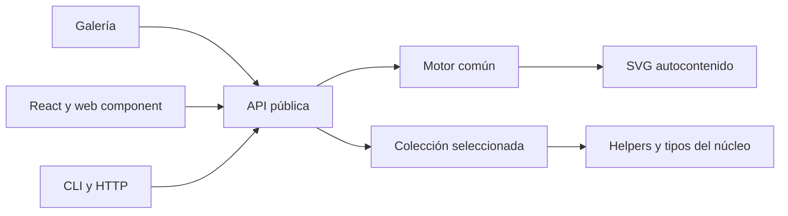

# Arquitectura de lazy-avatars

Estado: motor y fases 1–3 implementados, con trece colecciones y galería completa. Fecha: 2026-10-24. La [guía](../PLAN.md) define las colecciones y el alcance; este documento concreta los límites técnicos. Los adaptadores corresponden a la fase 4. El CI ejecuta la matriz remota en [GitHub Actions](https://github.com/paulaquiin/lazy-avatars/actions/workflows/ci.yml).

## 1. Decisión principal

Monorepo TypeScript con pnpm workspaces. El producto principal será una librería de funciones puras que recibe una colección y opciones y devuelve un SVG autocontenido. No necesita base de datos, almacenamiento de imágenes, red ni framework de interfaz.

Esta estructura permite compartir contratos y pruebas entre las colecciones sin obligar a sus consumidores a instalar la galería o las integraciones. No añadiremos un orquestador de monorepo mientras los scripts de pnpm sean suficientes.

```text
lazy-avatars/
├── packages/
│   ├── core/                  # lazy-avatars: motor y subrutas de colecciones
│   │   └── src/
│   │       ├── index.ts       # API y tipos comunes; no importa colecciones
│   │       ├── engine/        # hash, rng, svg, color, initials y glyphs
│   │       ├── themes/        # temas y roles de color
│   │       └── collections/   # una carpeta por colección
│   ├── react/                 # fase 4: @lazy-avatars/react
│   ├── web-component/         # fase 4: elemento <lazy-avatar>
│   ├── cli/                   # fase 4: @lazy-avatars/cli
│   └── http/                  # fase 4: servidor autoalojable y Dockerfile
├── apps/
│   └── gallery/               # Vite + TypeScript, sin framework
├── docs/                      # documentación pública
├── PLAN.md
├── README.md
├── README.es.md
└── LICENSE
```

Los directorios de código se crearán en su fase, sin paquetes vacíos. Los nombres npm son provisionales hasta comprobar su disponibilidad.

## 2. Dependencias y responsabilidades

| Componente  | Responsabilidad                                                   | Límites                                                                 |
| ----------- | ----------------------------------------------------------------- | ----------------------------------------------------------------------- |
| Motor       | Normalización, hash, RNG, color, glifos, SVG y envoltorio         | Sin DOM, red, reloj, estado global mutable ni dependencias de ejecución |
| Colección   | Dibujo, paletas, variantes y opciones tipadas                     | Usa contratos/helpers del núcleo; no importa otras colecciones          |
| Galería     | Controles, previsualización, URL compartible, descarga y ejemplos | Consume la API pública; sus dependencias nunca pasan al núcleo          |
| Adaptadores | Integración con React, custom elements, terminal o HTTP           | Consumen la API pública, sin duplicar el motor                          |



El consumidor importa explícitamente `lazy-avatars/rack`, por ejemplo, y pasa la colección a `createAvatar`. La entrada raíz no registra ni reexporta todas las colecciones. El mapa `exports` declarará únicamente API, tipos y subrutas públicas, sin exponer rutas internas accidentales. Las opciones de cada colección conservarán su inferencia TypeScript.

## 3. Flujo de generación y determinismo

1. Validar la colección y las opciones; normalizar la semilla con `trim()` + NFC. Conservar mayúsculas. Rechazar semillas vacías o de más de 1024 unidades UTF-16. Tamaño entero de 1 a 4096, predeterminado 64; forma predeterminada `rounded` y fondo activado. El [contrato del núcleo](../packages/core/README.md) recoge el resto de límites.
2. Codificar en UTF-8 y aplicar FNV-1a de 32 bits a `${collection.id}:${seed}`. Los vectores de prueba fijarán el comportamiento para ASCII y Unicode.
3. Crear un RNG `mulberry32`. Cada `fork(nombre)` se deriva de la semilla raíz y de la ruta completa del subflujo, sin consumir el flujo padre. Los rasgos usan nombres estables (`palette`, `eyes`, etc.).
4. Resolver paleta y opciones sin alterar subflujos de otros rasgos. El orden de las opciones no debe modificar la salida.
5. Dibujar el contenido en `80 × 80`; aplicar forma, fondo, tamaño, título escapado y espacios de nombres en el envoltorio común. Usar serialización canónica, números finitos y redondeo a un decimal, normalizando `-0` a `0`.
6. Devolver el SVG o codificarlo como data URI, sin acceder al entorno.

El contrato completo es: **misma colección + misma `outputVersion` + misma semilla normalizada + mismas opciones efectivas = mismos bytes**. Añadir variantes, cambiar glifos, probabilidades o serialización puede alterar resultados anteriores y exige revisar snapshots y versiones. Un hash de 32 bits puede colisionar: determinismo no implica un avatar exclusivo para cada identidad ni sirve para seguridad o anonimización.

Antes de 1.0, los cambios de salida se registrarán en el changelog y actualizarán `outputVersion`. Desde 1.0 requerirán también una versión mayor del paquete. `outputVersion` identifica el contrato, pero no selecciona renderizadores históricos: quien necesite conservar una salida debe fijar la versión del paquete o guardar el SVG.

## 4. Identificadores SVG e integración inline

Un prefijo que dependa solo de la semilla no evita que dos instancias iguales, o dos avatares con distintas formas, compartan IDs en el mismo documento HTML.
- Evitar IDs y referencias cuando la geometría lo permita.
- Para las referencias necesarias, derivar el prefijo de la identidad completa de renderizado, con serialización canónica de las opciones. La función `ctx.id(nombre)` añade un sufijo local estable.
- La API incluye `idPrefix?: string`: un espacio de nombres explícito y validado para instancias inline. El llamador debe dar un prefijo diferente a cada instancia del mismo documento, incluidas las repeticiones del mismo avatar. Los IDs del envoltorio están separados de los de la colección (`ctx.id`). No hay aleatoriedad ni contador global en el núcleo.
- Documentar que el modo predeterminado determinista no garantiza unicidad documental al repetir SVG inline. Para uso simple, un `` con data URI mantiene cada SVG en su propio documento.
- El adaptador React podrá proporcionar el prefijo estable por instancia con su mecanismo de IDs; se comprobará también la hidratación SSR.

Las pruebas cubrirán IDs duplicados, referencias sin destino y varias instancias con distintas opciones. Si se incluye `idPrefix`, también forma parte de la entrada que determina los bytes.

## 5. Color, accesibilidad y recursos

Las paletas tienen exactamente cinco roles: `background`, `primary`, `secondary`, `accent`, `ink`. Los temas implementados son `pastel`, `corporate`, `night`, `earth` y `mono`. Son sus IDs públicos; sus etiquetas se pueden traducir. Los IDs de temas se resuelven en un registro separado. `PaletteInput` admite un tema, una paleta explícita o una lista no vacía; los colores se validan como hex `#RGB` o `#RRGGBB` y se normalizan a seis dígitos.

`readable()` selecciona el primer candidato con contraste de al menos 3:1; si ninguno cumple, usa el de mayor contraste entre negro y blanco. Este umbral no garantiza por sí solo la accesibilidad de toda una interfaz. Rack conservará el significado del color de estado; sus ejemplos incluirán también una etiqueta textual del estado.

Las letras se dibujarán como paths o rectángulos, sin fuentes remotas. Se prefiere arte propio; si se convierten fuentes OFL, se revisarán sus términos y se incluirán los avisos exigidos antes de distribuirlas. La compatibilidad de licencias no se da por supuesta.

El SVG no tendrá scripts, manejadores de eventos ni recursos externos. No aceptará fragmentos SVG arbitrarios como opciones. Semillas, títulos, colores e identificadores se validarán o escaparán según su contexto. Los fixtures usarán datos ficticios y se probarán caracteres XML especiales.

## 6. Herramientas y publicación

| Área       | Decisión                                                    |
| ---------- | ----------------------------------------------------------- |
| Lenguaje   | TypeScript estricto                                         |
| Workspace  | pnpm, versión fijada y lockfile versionado                  |
| Build      | tsup; ESM y declaraciones, una entrada por colección        |
| Pruebas    | Vitest; unitarias, snapshots y compatibilidad de navegador  |
| Estilo     | Biome                                                       |
| Versionado | Changesets; contrato de SVG ligado a versiones              |
| CI         | GitHub Actions: lint, tipos, tests, build, tamaño y paquete |
| Galería    | Vite + TypeScript; despliegue estático en GitHub Pages      |

La salida actual es ESM y tipos, sin CommonJS. Desarrollo: Node `^24.11.0 || >=26.0.0`, pnpm 11.25.0, TypeScript 5.9.3, tsup 9.0.0, Vitest 5.0.5, Biome 2.6.2, Changesets 3.0.3, Vite 8.3.5 y Playwright 1.64.1. Las versiones y dependencias transitivas están fijadas por manifiesto y lockfile. La verificación local usa Node 24.21/Chromium en Windows; los resultados de las otras combinaciones se registran en GitHub Actions. React será una dependencia peer del adaptador, no del núcleo.

El workspace raíz y la galería son privados para npm. El núcleo define `files` con lista positiva y el export raíz del motor y subrutas separadas para mosaic, monogram, rack, siesta, origami, pantry, deco, latte y constellation. `pnpm check:package` verifica una lista positiva de entradas, chunks y tipos alcanzables, junto con README, licencia, changelog y manifiesto, tamaños máximos de 24 KiB ESM y 8 KiB gzip para el grafo alcanzable del motor, ausencia de dependencias de ejecución y patrones de credenciales, y una instalación real offline en un directorio temporal con importación ESM y comprobación de tipos. El ejemplo de SVG tiene un objetivo orientativo de 4 KiB. La licencia se copia desde la raíz durante el build y no se duplica en Git. Véanse las [reglas de higiene](REPOSITORY_HYGIENE.md).

## 7. Calidad y decisiones pendientes

El orden de implementación y los criterios verificables están en las [fases de la guía](../PLAN.md#9-hoja-de-ruta). La fase 3 tiene 117 pruebas unitarias, 20 snapshots por colección más la figura del motor y 26 pruebas de Chromium. El paquete se prueba instalado fuera del monorepo con todos sus exports y tipos. Los glifos de píxel de Rack, los trazos serif de Monograma y los sans de Misión son originales MIT. El CI publica solo apps/gallery/dist tras aprobar la matriz. v0.3.0 publicada y verificada desde npm con trece subrutas, tipos e integridad; CI y Pages aprobados para el commit publicado. No hay tokens en el repo.

El núcleo `lazy-avatars@0.1.0` se publicó el 2026-10-24. Los futuros paquetes `@lazy-avatars/*` siguen pendientes de acreditar/reservar su scope; un 404 no concede propiedad. La matriz remota de CI ya se ejecuta en GitHub; sigue pendiente comprobar compatibilidad real con Deno, Bun y edge. Los scripts públicos de comprobación son parte reproducible del proyecto; las herramientas privadas o de esta sesión quedan excluidas.

Las cinco colecciones de fase 2 añaden exclusivamente módulos de dibujo/paletas y subrutas: no cambian el motor ni los snapshots de fase 1. Déco y Constelación usan trazos principales de 2.5 unidades del viewBox y selección de contraste de 3:1. El paquete preparado contiene 28 archivos permitidos; el grafo raíz conserva 16 380 bytes ESM y 5 408 bytes gzip. v0.2.0 está publicada y verificada desde el registro con las nueve subrutas y tipos públicos; véase [la revisión de fase 2](PHASE2_REVIEW.md).

Las cuatro colecciones de fase 3 amplían subrutas sin cambiar el motor ni los 180 snapshots anteriores. Sus clips tienen IDs por instancia; Órbita separa anillos traseros y delanteros, Casco recorta los reflejos al visor y Misión usa glifos sans propios. El paquete preparado contiene 36 archivos permitidos; el grafo raíz conserva 16 380 bytes ESM / 5 408 bytes gzip. Véase [la revisión de fase 3](PHASE3_REVIEW.md).
